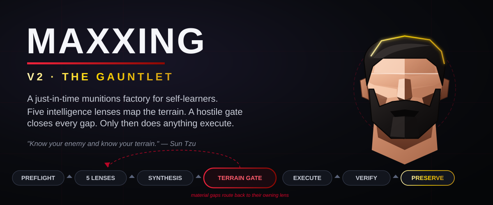
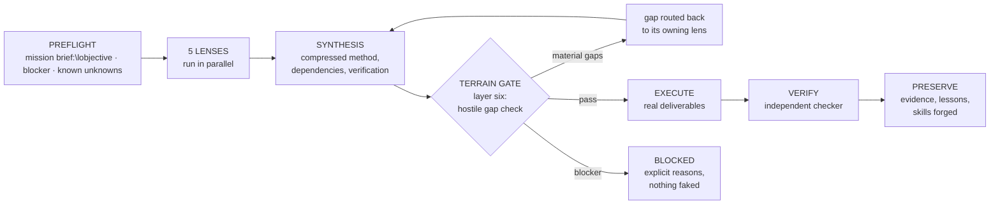

<p align="center">
  
</p>

<p align="center"><em>Research deeply. Move decisively. Compound the skill.</em></p>

# Maxxing

> **Turn unfamiliar territory into a working plan, and then into the thing itself.**

Maxxing is a just-in-time munitions factory for self-learners. Give it a mission you have never done before and it scouts the terrain through five independent intelligence lenses, compresses what it finds into the minimum knowledge the mission actually needs, refuses to execute until a hostile gate has closed every material gap, then builds the thing, tests it, and keeps what it learned.

It is built on the [Claude Agent SDK](https://github.com/anthropics/claude-agent-sdk-typescript).

> **Repo status:** V2 lives on the `v2-gauntlet` branch. The `master` branch remains the V1 baseline.

[](https://nodejs.org/)
[](https://www.typescriptlang.org/)
[](https://github.com/Tulip9ZZZA/maxxing-itout)
[](https://github.com/anthropics/claude-agent-sdk-typescript)
[](LICENSE)
[](V2_PROGRESS.md)

```txt
"Know your enemy and know your terrain."
                            — Sun Tzu
```

## Contents

- [Why Maxxing exists](#why-maxxing-exists)
- [The philosophy](#the-philosophy)
- [How it works: the Gauntlet](#how-it-works-the-gauntlet)
- [The five lenses](#the-five-lenses)
- [The sixth layer: the Terrain Gate](#the-sixth-layer-the-terrain-gate)
- [Terrain memory](#terrain-memory)
- [Quick start](#quick-start)
- [Configuration](#configuration)
- [Safety](#safety)
- [Repository map](#repository-map)
- [What is verified (and what is not)](#what-is-verified-and-what-is-not)
- [V1 → V2](#v1--v2)
- [Contributing](#contributing)
- [License](#license)

## Why Maxxing exists

College stocks a warehouse. It trains you broadly for years before it lets you near a job, on the theory that you should be good at the whole discipline first. Self-learners took a different door. They tinker. They config-hop between half-finished projects. They learn exactly one thing at the moment they need it, which is either brilliant or chaos depending on whether anyone mapped the terrain.

AI deleted the warehouse. A model that can hand you the one command that unblocks the one action between you and your goal makes the twelve-week curriculum optional. What it cannot do is look at the hill you are about to die on and tell you it is mined.

That is the gap Maxxing closes. Most people do not quit new things because the things are hard. They quit because the unknown feels like a verdict on their talent: the missing dependency they could not have known about, the amateur mistake they did not know was amateur, the plan that was confident noise from the start. Map the terrain first and the unknown stops being a verdict. It becomes a checklist. You can try the new thing without fearing you will look like an amateur, because the amateur traps are on the map now.

You do not need to master a discipline to accomplish something inside it. You need the specific knowledge required for the specific action that finishes your goal. Maxxing exists to find that knowledge, verify it, and hand it to you as ammunition.

## The philosophy

1. **You do not stockpile shells. You forge the shell when the tank crosses the ridge.** Research happens for the mission at hand, in context, immediately usable. No curriculum, no prerequisites queue, no "finish chapter four first."
2. **The terrain is real or it is not research.** Every claim has a source, a date, and a confidence. Popularity is not evidence. A quiet staff engineer's repository outranks a famous influencer's thread.
3. **The corpses matter as much as the trophies.** Reverse engineering studies abandoned repos, closed issues, and postmortems. Winners' highlight reels produce survivorship bias dressed as method.
4. **Truth outranks agreement.** The first-principles lens will happily argue with you, with the experts, and with itself. An agent that only supports your idea is a mirror, and mirrors do not scout terrain.
5. **Nothing executes until the gate says so.** A large amount of research is not quality. Five confident reports can share one fatal blind spot. The gate exists because of that sentence.
6. **What you learn should compound.** Evidence, gaps, lessons, and outcomes persist. The second mission starts from the first mission's map.

## How it works: the Gauntlet



Each phase persists before the next begins. A crashed run resumes from its last persisted phase with `maxxing resume <mission-id>`.

## The five lenses

The lenses run in parallel. Each is an independent scout with its own prompt, turn budget, and obligation to report what it could not verify. Full contracts live in [`prompts/`](prompts).

| Lens | Question it owns | What it refuses to do |
| --- | --- | --- |
| 1 · Elite performance | How do the top 1% actually operate here? | Confuse popularity with expertise |
| 2 · Reverse engineering | How was the strongest real artifact built, and why did the failed ones die? | Learn only from polished success stories |
| 3 · Fundamentals | What must be true before anything else? | Let a sophisticated plan sit on unverified basics |
| 4 · First principles | What is causally true, stripping every borrowed assumption? | Defend an idea because it belongs to you |
| 5 · Pro vs amateur | What exactly separates a professional result from an amateur one? | State a standard that cannot be checked |

## The sixth layer: the Terrain Gate

Layer six is not a sixth lens and not a sixth step. It is the filter at the exit of the pipe. Everything the five lenses produced gets inspected there, and only a round with zero open material gaps ships.

The gate runs two kinds of inspection. The first is deterministic: checks in code that no model output can argue away:

- a synthesis that does not exist (blocker)
- a lens that produced no findings
- a blind spot no synthesis entry covers
- an empty dependency inventory
- a success criterion with no verification method
- contradictory evidence left unresolved (contradictions are declared by the synthesizer; the gate agent hunts them semantically)
- a known unknown nobody explored
- evidence below the minimum floor
- a key claim anchored on evidence with confidence below 0.4
- a key claim citing an evidence id that does not exist

The second is a hostile model pass over the synthesis, answering the nine questions below. If that pass cannot run at all, the round blocks: a silent hostile layer is not the same as its approval.

1. What did we overlook?
2. Which assumptions remain unverified?
3. What important information is missing?
4. Which dependencies, tools, resources, or constraints did we fail to investigate?
5. What contradicts our current understanding?
6. Did we reverse-engineer the right examples?
7. Did we neglect something fundamental?
8. Did we mistake an impressive demonstration for a proven implementation?
9. What could make this entire plan fail when it meets reality?

Every gap is logged with its question, severity, and owning lens. Material gaps route back to the owning lens for targeted re-research, the synthesis is rebuilt, and the gate runs again. The loop is capped (`maxGateRounds`, default 3). At the cap, unresolved material gaps become explicit blockers and the mission stops with a straight answer instead of a confident performance:

```json
{
  "phase": "blocked",
  "verdict": "blocked",
  "blockers": [
    "the plan assumes a Vercel account exists; nothing verified the user has one"
  ]
}
```

Every verdict is logged with its rationale, and every gap records the question that caught it, its severity, and its owning lens. Over time that log becomes the thing college was supposed to give you: a map of where your own blind spots live.

## Terrain memory

Everything the Gauntlet learns persists in SQLite at `~/.maxxing/terrain.db` (configure with `MAXXING_HOME`). One schema, one purpose: the next session starts from the last session's map.

| Record | What it keeps |
| --- | --- |
| `missions` | objective, brief, current phase, gate round |
| `evidence` | claim, source URL, quote, confidence, lens, contradictions, status |
| `gaps` | the gate question that caught it, severity, owner, resolution |
| `gate_rounds` | verdict and rationale per round |
| `attempts` | deliverables and per-criterion verification verdicts |
| `lessons` | what worked, what failed, under what conditions, tagged by domain |

Before the lenses run, the store is queried for lessons whose tags overlap the new mission. The lenses see the accumulated terrain. A mistake from mission one surfaces as a warning in mission five.

## Quick start

You need Node.js 24 or newer and [Claude Code authentication](https://docs.claude.com/en/docs/claude-code) (a `ANTHROPIC_API_KEY` or a logged-in Claude Code session).

```bash
git clone https://github.com/Tulip9ZZZA/maxxing-itout
cd maxxing-itout
npm install
```

Run a full mission:

```bash
npx tsx src/index.ts run "deploy my static site to a VPS with HTTPS tonight"
```

What you will see: the preflight brief, five lenses scouting in parallel, a synthesis, gate rounds (with gaps named and closed), execution in the mission directory, an independent verification pass, and an honest completion report at `~/.maxxing/missions/<id>/report.md`.

Get the intelligence without the execution (useful, and cheaper):

```bash
npx tsx src/index.ts run "is React Server Components worth it for my dashboard?" --scout-only
```

Commands:

| Command | What it does |
| --- | --- |
| `run "objective"` | Full Gauntlet: preflight → lenses → synthesis → gate → execute → verify |
| `run --scout-only` | Stop after the Terrain Gate passes |
| `run --rounds N` | Cap the gate's revise loop (1–10, default 3) |
| `resume <mission-id>` | Continue a mission from its persisted phase |
| `map` | List missions and lessons (the terrain map) |
| `report <mission-id>` | Print a mission's completion report |
| `lessons` | Print all terrain lessons |
| `forge <mission-id>` | Forge a reusable skill from a completed mission's terrain (evidence-gated) |
| `config` | Print the resolved configuration |

`--json` on `run`, `resume`, `map`, and `lessons` emits machine-readable output.

## Configuration

Drop a `maxxing.config.json` in your working directory (see [`maxxing.config.example.json`](maxxing.config.example.json)):

```json
{
  "model": "claude-sonnet-4-6",
  "maxGateRounds": 3,
  "minEvidence": 3,
  "codeExecution": true,
  "webScout": true,
  "permissionMode": "acceptEdits"
}
```

Environment overrides: `MAXXING_HOME`, `MAXXING_MODEL`, `MAXXING_MAX_GATE_ROUNDS`, `MAXXING_PERMISSION_MODE`. See [`.env.example`](.env.example).

## Safety

A permission callback sits between every agent and every tool call. It denies, unconditionally:

- `git push`, `npm publish`, `gh release create`, and any other publishing or releasing operation
- `curl ... | sh` and every variant of piping remote content into a shell
- `rm -rf`, `mkfs`, `dd` to raw devices, `chmod 777` on absolute paths
- reading `.env` files, SSH keys, and certificate material

Nothing is pushed, published, released, or spent without explicit user authorization. Secrets that pass through logs are redacted. With `codeExecution: false`, every shell command is refused.

## Repository map

```txt
maxxing-itout/
├── src/
│   ├── index.ts              entrypoint
│   ├── cli.ts                run · resume · map · report · lessons · config
│   ├── config.ts             defaults < file < env
│   ├── safety.ts             the canUseTool policy
│   ├── core/                 types, ids, tolerant JSON parsing
│   ├── agent/client.ts       AgentClient seam (real SDK ↔ test fakes)
│   ├── store/store.ts        TerrainStore over node:sqlite
│   └── pipeline/
│       ├── orchestrator.ts   the Gauntlet state machine + resume + reports
│       ├── preflight.ts      mission brief interrogation
│       ├── lenses.ts         five lenses, parallel, blind-spot aware
│       ├── synthesize.ts     compression to the Pareto core
│       ├── gate.ts           deterministic checks + hostile gate agent
│       ├── execute.ts        execution + independent verification
│       └── forge.ts          evidence-gated skill creation
├── prompts/                  every agent contract, editable markdown
├── skills/                   deep-research · terrain-scout · skill-forge
├── eval/                     adversarial end-to-end scenarios + runner
├── tests/                    58 tests, no API key required
├── docs/                     architecture, gate spec, evidence schema
└── assets/                   mascot (full + headshot), hero, V1 aura
```

Deeper detail: [`docs/ARCHITECTURE.md`](docs/ARCHITECTURE.md), [`docs/TERRAIN_GATE.md`](docs/TERRAIN_GATE.md), [`docs/EVIDENCE.md`](docs/EVIDENCE.md).

## What is verified (and what is not)

This section exists because "the code looks impressive" is the exact failure the Terrain Gate exists to catch, and a README that flatters its own repository would be a self-portrait of it.

Verified against the installed SDK (`@anthropic-ai/claude-agent-sdk` 0.3.x) in this build:

- TypeScript compiles clean with `strict` on, against the real SDK's published types.
- 70 tests pass. They cover the deterministic gate checks against eleven planted flaws (missing dependency inventory, silent lens, unaddressed blind spot, misleading low-confidence source, fabricated citation, unmapped success criterion, unresolved contradiction, unexplored unknown, thin scouting, missing synthesis, verdict logic at the round cap), the full Gauntlet pipeline over scripted agents (pass, revise-then-pass, blocked, scout-only, resume), the store, config, prompt loading, and parsing. A separate regression file pins every weakness the independent critique round found: eleven Bash bypass attempts against the safety policy, a blocked mission being resumed into a fake done, a hostile gate pass dying mid-round, an unreachable contradiction check, duplicate evidence on resume, and a forge command wired to nothing.
- The eval runner's no-credentials path reports `SKIPPED` per scenario. Skipped is reported as skipped, never as passed.

Not verified in this build, and not claimed:

- Live end-to-end runs against the real model. `npm run eval` executes three adversarial scenarios (planted missing dependency, planted misleading source, planted incomplete plan) through the real pipeline when `ANTHROPIC_API_KEY` is set, and writes `eval-results.json` you can audit by hand. Run it and see.
- Behavior under every possible model response shape. The parsers are tolerant and their failure paths are tested (unparseable output becomes a logged gap, never a fake pass), but real models will invent new ways to surprise you.

## V1 → V2

| | V1 | V2 |
| --- | --- | --- |
| Shape | One-shot firehose: one prompt, streamed to stdout | State machine with persisted phases and resume |
| Research | One multi-lens paragraph inside a system prompt | Five parallel lens agents with evidence discipline |
| Quality control | None — whatever the model said, happened | Terrain Gate: deterministic checks + hostile pass, capped revise loop |
| Evidence | Undefined | First-class records: source, date, quote, confidence, contradictions |
| Memory | None between sessions | SQLite terrain store; lessons recalled by tag overlap |
| Execution | Ask the model to produce an artifact | Executor in a mission directory + independent verifier |
| Failure handling | None | Unparseable output becomes a logged gap; caps become explicit blockers |
| Skill forge | On demand | Evidence-gated, same structure |
| Self-assessment | The README did the heavy lifting | 58 tests, adversarial eval suite, honest verified/unverified split |

The V1 loop (Diagnose, Research, Compress, Apply, Skill-forge) survives as phases: preflight is Diagnose, the lenses are Research, synthesis is Compress, execution and verification are Apply, and the forge still forges.

## Contributing

The prompt files in `prompts/` are where the system's behavior lives, in plain markdown. If you want to change how Maxxing thinks, change them and run `npm test` — the pipeline is covered end to end by scripted agents, so prompt and logic changes are safe to iterate on without credentials.

Good first contributions: a new deterministic gate check with its adversarial test, a new eval scenario, a lens sharpening that survives the blind critics, and platform packaging (the SDK also ships Python and browsers).

Run before every PR:

```bash
npm run typecheck && npm test
```

## License

[MIT](LICENSE)

## Credits

Built by [Tulip9ZZZA](https://github.com/Tulip9ZZZA). Powered by the [Claude Agent SDK](https://github.com/anthropics/claude-agent-sdk-typescript). The ideology is two thousand years older than the code: know your enemy and know your terrain, and a thousand battles cost a thousand victories less.
