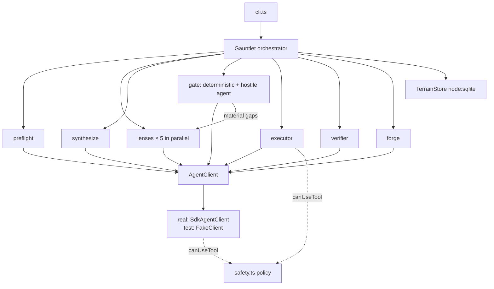

# Architecture

## The shape

Maxxing V2 is a state machine wrapped around parallel scouting agents, with a gate before execution and a store behind everything.



## The seam

Everything that thinks goes through `AgentClient.run(prompt, opts)`. Production uses `SdkAgentClient` (the real SDK `query()` loop, collecting assistant text and the success result). Tests use `FakeClient`, which dispatches on the system prompt to return canned JSON per stage. The pipeline code cannot tell the difference — which is the point. One seam, two implementations, zero network in the test suite.

## Phases and persistence

| Phase | Produces | Persisted as |
| --- | --- | --- |
| `preflight` | `MissionBrief` (objective, blocker, known unknowns, criteria, tags, assumptions) | `missions.brief` |
| `lenses` | 5 × `LensReport` + evidence records | `lens_reports`, `evidence` |
| `synthesis` | `Synthesis` (terrain summary, cited key claims, dependency inventory, method, verification map, covered unknowns, pro standards, risks) | `synthesis` |
| `gate` | `GateRoundRecord` per round + `Gap` records | `gate_rounds`, `gaps` |
| `execute` | `Attempt` (summary, deliverables) | `attempts` |
| `verify` | per-criterion verdicts on the attempt | `attempts` (upsert) |
| `done` | lessons + `report.md` | `lessons`, mission dir |

Every phase transition calls `store.updateMission` before the next phase starts. `resumeMission(id)` loads the record and re-enters `runFromPhase` at the persisted phase. Re-running a phase is safe: lens reports upsert by `(mission, lens)`, synthesis upserts by mission, attempts upsert by id.

## The gate loop

```txt
round = 1
while round <= maxGateRounds:
    candidates = deterministicChecks(...) + gateAgent(...)
    verdict = decide(candidates, round, maxGateRounds)
    if verdict == pass: break
    if verdict == blocked or no open material gaps: → blocked
    for each material gap: owning lens re-scouts (targeted prompt)
        new evidence relevant to the gap closes it; otherwise it stays open
    re-synthesize from all reports + evidence
    round += 1
if verdict != pass: → blocked (material gaps become explicit blockers)
```

`decide` is pure: blocker-severity blocks immediately, material gaps revise below the cap and block at it, minor gaps pass with a log line. The revise loop only routes material gaps.

## Failure posture

| Failure | Handling |
| --- | --- |
| Lens agent throws | Caught per lens; `failedReport` records a blind spot; gate catches the silent lens |
| Lens output unparseable | `parseLensReport` returns a zero-findings report; gate's silent-lens check fires |
| Synthesis unparseable | `null`; gate returns a blocker; mission blocks honestly |
| Gate output unparseable | Degrades to a minor gap; deterministic checks still ran |
| Gap cannot be closed by research | Lens returns blind spots; gap stays open; at cap it blocks with the reason |
| Denied tool call | `canUseTool` deny with message; agent records it in notes instead of faking success |

## Why the report always distinguishes verified from unverified

The verifier is a different agent from the executor, and its verdicts are per-criterion with a `detail` field naming what was actually inspected or run. The completion report repeats those verdicts verbatim and states plainly when no execution attempt exists. A pipeline whose product is honesty cannot allow its own summary to blur that line.
